

# Jotsy

**一本只属于你的本地日记**

免费 · 开源 · 无广告 · 无需注册 · 数据只存在你的手机里

简体中文 | [English](docs/README.en.md)

  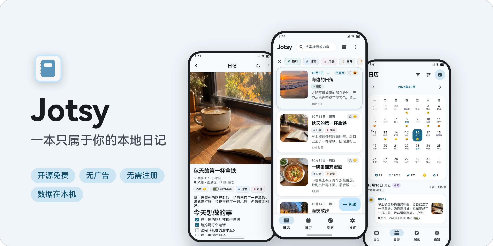

Jotsy 想做一个纯粹的记录工具：打开就能写，不用登录，没有广告。心情、灵感、一日三餐、出门旅行，连同照片、视频和录音，都安安静静地留在你自己的手机里。

## ✨ 为什么选择 Jotsy

| | |
| :-- | :-- |
| 🔒 **私密** | 数据全部存在本机，没有账号和服务器；支持应用锁，备份可加密 |
| ✍️ **好写** | 富文本编辑，图片、视频、附件、录音随手插入 |
| 🌤️ **有温度** | 每篇日记都能记下心情、精力、天气和地点 |
| 📅 **好回顾** | 农历日历、年度热力图、那年今日、时间胶囊 |
| 📦 **不锁定** | ZIP 备份、WebDAV 同步，导出 PDF / Word / Markdown / 网页 / TXT / CSV；支持从 18 款应用导入 |
| 🎨 **好看** | Material 3 Expressive 设计，明暗主题，80 种主题色 |

## 📱 功能一览

### ✍️ 写作：富文本、多媒体与"此时此地"

<table>
  <tr>
    <td align="center">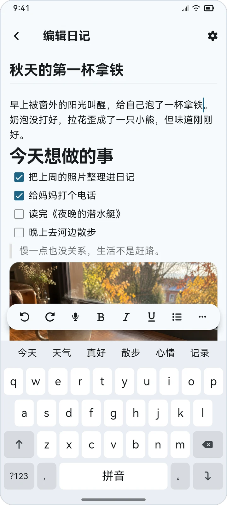 富文本编辑与悬浮工具栏</td>
    <td align="center">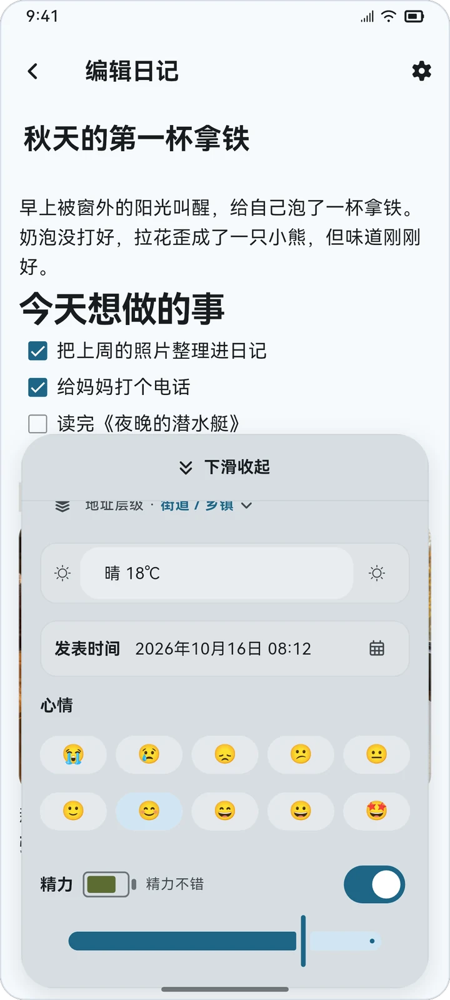 天气、心情与精力</td>
    <td align="center">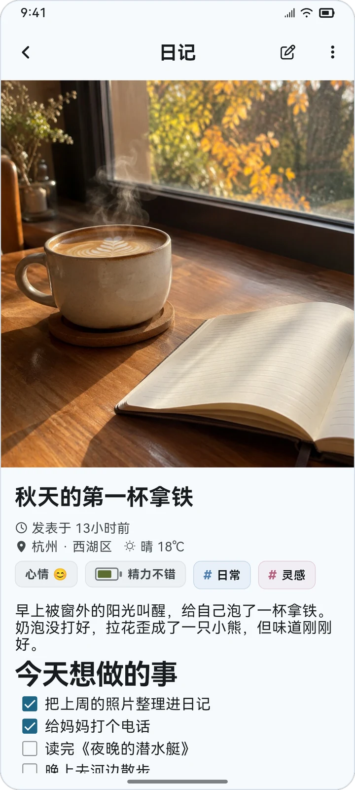 日记详情</td>
  </tr>
</table>

- **23 种编辑工具**：标题、加粗 / 斜体 / 下划线 / 删除线、文字颜色与背景色、有序 / 无序 / 待办清单、引用、代码块、链接、插入当前时间……工具栏的顺序和显隐都能自定义。
- **多媒体**：一次插入多张图片或多段视频，添加任意类型的附件；录音支持暂停与继续，回放时可以拖动波形。
- **此时此地**：自动定位并获取天气，也可以手动填写；地址精度可选城市、区县、街道或门牌号。
- **心情与精力**：10 个心情 Emoji（可在设置里替换）和 5 档精力值，发表时间也可以随时修改。
- **不怕丢稿**：新建时自动保存草稿，编辑已有日记时自动保存。

### 🗂️ 浏览与整理

<table>
  <tr>
    <td align="center">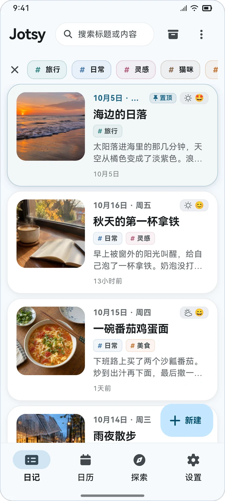 列表视图</td>
    <td align="center">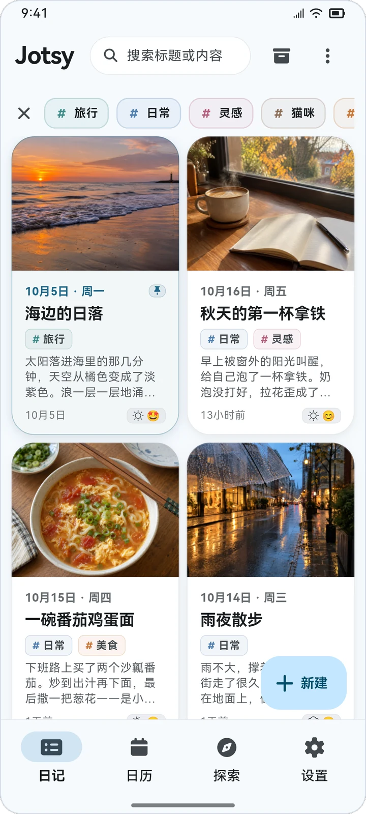 瀑布流视图</td>
    <td align="center">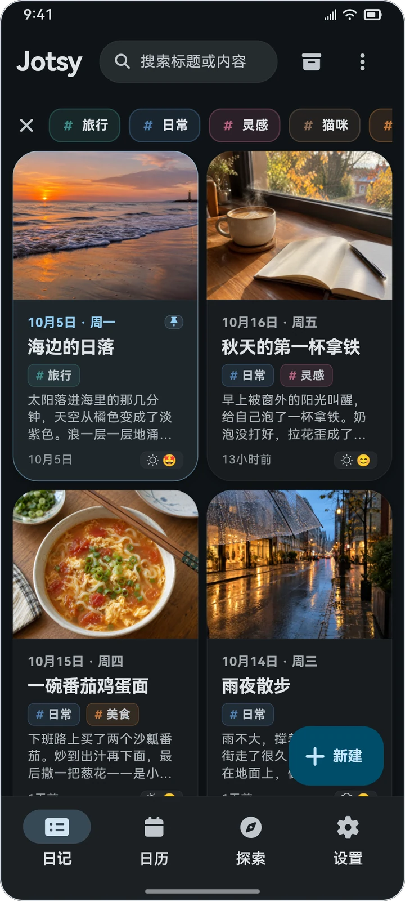 暗色主题</td>
  </tr>
</table>

- 列表、瀑布流两种布局，可按更新时间、发表时间或标题排序。
- 按标签筛选（可以记住上次的筛选），搜索标题和正文时也能叠加标签条件。
- 置顶、归档（左滑即可）、多选批量操作；删除的日记进入回收站，并且可以立即撤销。

### 📅 日历：农历、心情与照片墙

<table>
  <tr>
    <td align="center">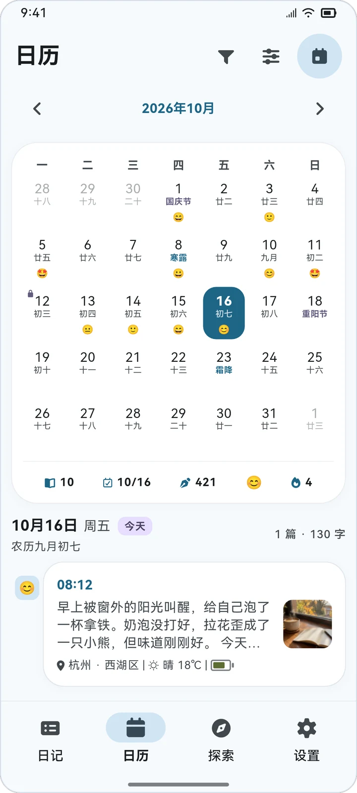 农历、节气与心情</td>
    <td align="center">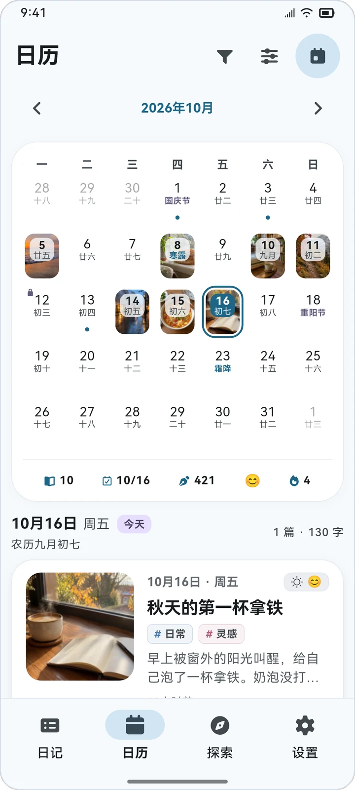 照片样式</td>
    <td align="center">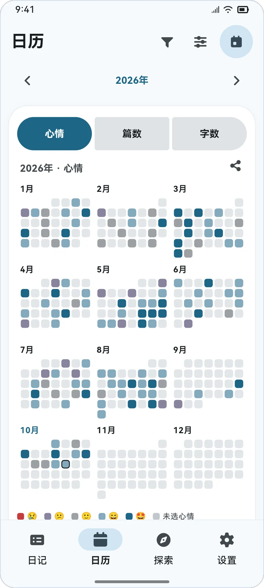 年度热力图</td>
  </tr>
</table>

- 月视图和周视图都能显示农历、节气与节日，日历下方汇总本月的篇数、记录天数、字数、最常见心情和最长连续记录。
- 日期格有 5 种样式：圆点、心情、热力、照片、标签；还可以按心情或标签筛选。
- 先选起点、再点终点，就能看这段日期的统计；年视图可以按心情、篇数或字数生成全年热力图，并分享为图片。
- 长按某一天可以补写日记，也可以给未来的某天写一颗时间胶囊。

### 🧭 探索与回忆

<table>
  <tr>
    <td align="center">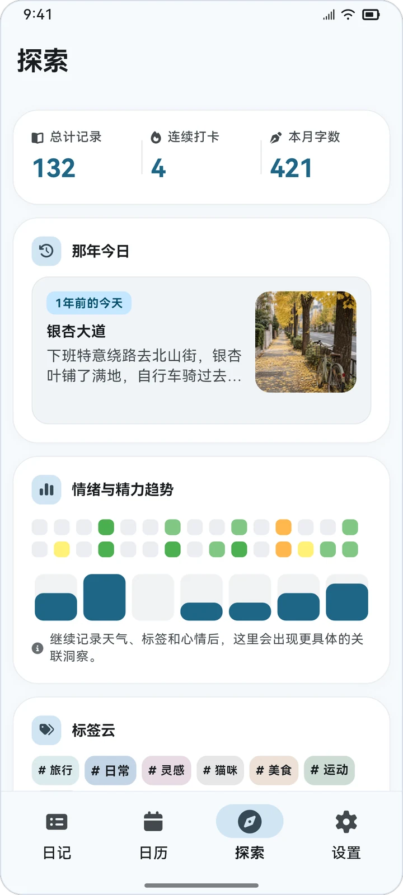 统计、那年今日与趋势</td>
    <td align="center">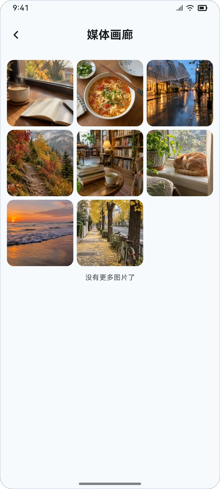 媒体画廊</td>
    <td align="center">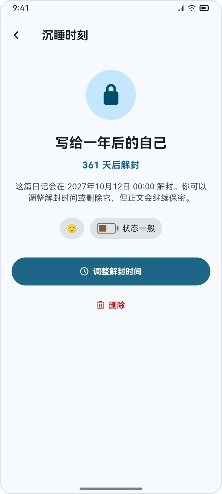 时间胶囊</td>
  </tr>
</table>

- 总记录数、连续打卡天数、本月字数一目了然。
- **那年今日**：自动翻出往年同一天写下的日记。
- **趋势与标签云**：近 30 天的心情、近 7 天的精力，以及最常用的标签。
- **媒体画廊**：所有封面和正文里的图片汇集在一起，可以放大浏览、保存或分享。
- **时间胶囊**：写给未来的日记会一直封存，到了解封日期才能打开。

### 🔐 数据、隐私与个性化

<table>
  <tr>
    <td align="center">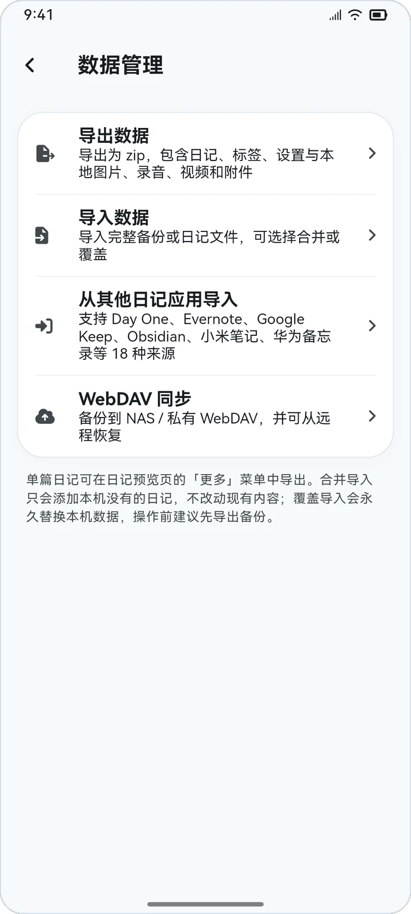 备份、导入与 WebDAV</td>
    <td align="center">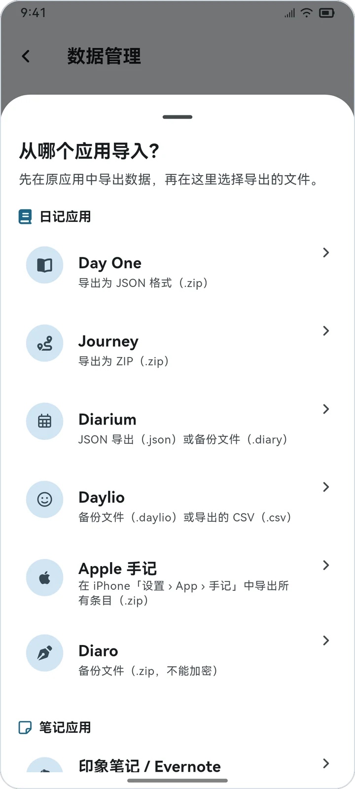 从 18 款应用导入</td>
    <td align="center">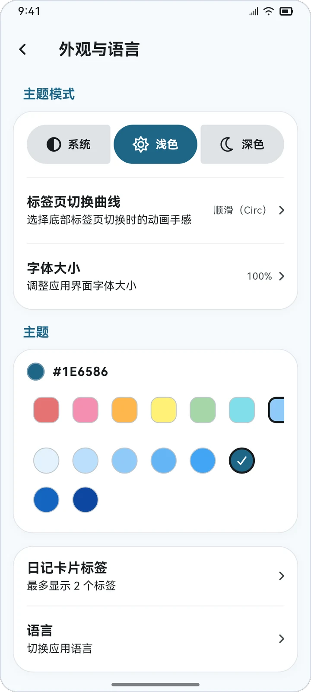 主题与外观</td>
  </tr>
</table>

- **应用锁**：用系统的生物识别或设备密码解锁。
- **完整备份**：导出为一个 ZIP，包含日记、标签、设置和全部图片、录音、视频与附件；可以设密码，使用 AES-256 加密。
- **两种导入方式**：恢复时可以选择"合并"或"覆盖"，覆盖本机数据前会有醒目的二次确认。
- **WebDAV**：备份到 NAS 或私有网盘，也能从远端直接恢复。
- **导出**：单篇、多选或按日期与标签批量导出为 PDF、Word、Markdown（带 front matter，可导入 Obsidian）、网页、纯文本、CSV，或者生成可以在另一台设备上合并导入的日记文件。
- **分享**：生成长图，或一键分享到微博、小红书、微信、QQ——正文自动复制，日记里的图片一起带上。
- **个性化**：10 个色系共 80 种主题色，可调界面字号、正文字号与行距，支持中文和 English。

## 🔁 从其他应用搬家

先在原应用里导出数据，再到 Jotsy 的 **设置 › 数据与隐私 › 数据管理 › 从其他日记应用导入** 中选择文件。导入前会先预检内容，同样可以选择合并或覆盖。

| 类型 | 支持的应用 |
| :-- | :-- |
| 日记应用 | Day One · Journey · Diarium · Daylio · Apple 手记 · Diaro |
| 笔记应用 | 印象笔记 / Evernote · Google Keep · Joplin · Memos · Markdown / 纯文本（Obsidian、Bear、Notion 导出等） |
| 云端笔记 | 小米笔记 · 华为备忘录 · OPPO 笔记 · vivo 笔记 · 荣耀笔记 · 魅族笔记 · WPS 便签 |

> 云端笔记需要在应用内打开对应厂商的官方网页登录，Jotsy 只读取笔记内容。登录 Cookie 只存在于本次导入的内存中，导入结束就会清除，不会写入存储，也不会用于其他请求。

## 📥 下载安装

> 目前只提供 Android 版本，需要 Android 7.0 及以上。

1. 打开 [Releases 页面](https://github.com/CikeSeven/jotsy/releases/latest)。
2. 根据设备下载对应的安装包：
   - `arm64-v8a`：绝大多数手机都选这个，不确定时也选它
   - `armeabi-v7a`：较老的 32 位设备
   - `x86_64`：模拟器
3. 安装后即可使用。之后可以在 **设置 › 关于** 中手动检查更新。

## 🛡️ 隐私说明

Jotsy 没有账号体系，也没有自己的服务器。日记保存在应用私有目录下的 SQLite 数据库里，图片、录音、视频和附件也放在同一目录，设置保存在本机。

只有下面这些情况会联网，而且都由你主动触发：

| 场景 | 访问对象 | 发送内容 |
| :-- | :-- | :-- |
| 自动获取地点和天气 | 高德地图、和风天气 | 当前坐标（不想用的话可以手动填写） |
| WebDAV 备份 / 恢复 | 你自己填写的服务器 | 备份文件 |
| 检查更新（手动） | GitHub Releases 及其镜像 | 不含任何日记数据 |
| 导入云端笔记 | 对应厂商的官方网站 | 你在官网完成的登录 |

用到的权限：网络、麦克风（录音）、位置（可选，用于自动定位）。

## ❓ 常见问题

<b>换手机了，日记怎么迁移？</b>

在旧手机的 **数据管理 › 导出数据** 中生成备份 ZIP，传到新手机后用 **导入数据** 恢复即可；也可以用 WebDAV 在两台设备之间中转。

<b>为什么获取不到天气和定位？</b>

请确认已经授予位置权限，并且网络正常。即使获取不到，也可以手动填写地点和天气。

<b>卸载应用会丢数据吗？</b>

会。数据只存在本机，卸载或清除应用数据都会把它删掉。建议定期导出备份，或者开启 WebDAV 备份。

<b>有 iOS 版吗？</b>

暂时没有，目前只发布 Android 版本。

## 💬 反馈与交流

- 遇到 Bug 或想提建议，欢迎提交 [Issue](https://github.com/CikeSeven/jotsy/issues)
- QQ 交流群：678136434

## 📄 开源许可

Jotsy 以 [GPL-3.0](LICENSE) 协议开源。

截图中的日记、照片和地点均为演示数据。
