


# Jotsy

**A private diary that lives on your phone**

Free · Open source · No ads · No account · Your data never leaves your device

English | [简体中文](../README.md)

  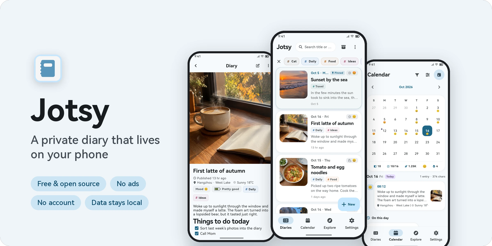

Jotsy is meant to be a plain, honest place to write. Open it and start typing: no sign-in, no ads. Your moods, ideas, meals and trips, along with photos, videos and voice notes, stay quietly on your own phone.

## ✨ Why Jotsy

| | |
| :-- | :-- |
| 🔒 **Private** | Everything is stored on your device. No account, no server. App lock and encrypted backups |
| ✍️ **Easy to write** | Rich text with images, videos, attachments and voice recordings |
| 🌤️ **Full of context** | Record mood, energy, weather and location with every entry |
| 📅 **Easy to look back** | Lunar calendar, yearly heatmap, On this day, time capsules |
| 📦 **No lock-in** | ZIP backups, cloud backup (WebDAV / object storage / major cloud drives), export to PDF / Word / Markdown / web page / TXT / CSV, import from 18 apps |
| 🎨 **Beautiful** | Material 3 Expressive design, light and dark themes, 80 theme colors |

## 📱 Features

### ✍️ Writing: rich text, media and "here and now"

<table>
  <tr>
    <td align="center">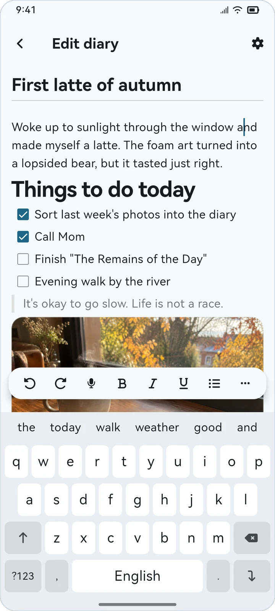 Rich text with a floating toolbar</td>
    <td align="center">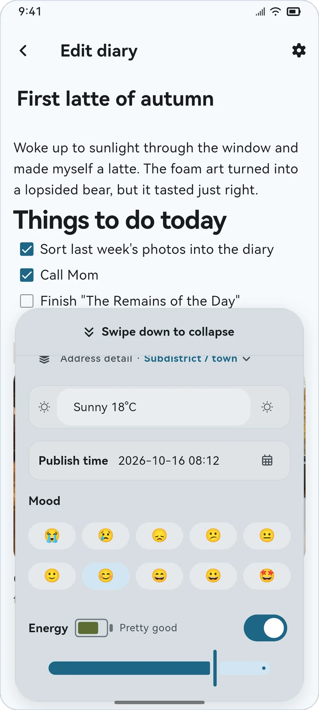 Weather, mood and energy</td>
    <td align="center">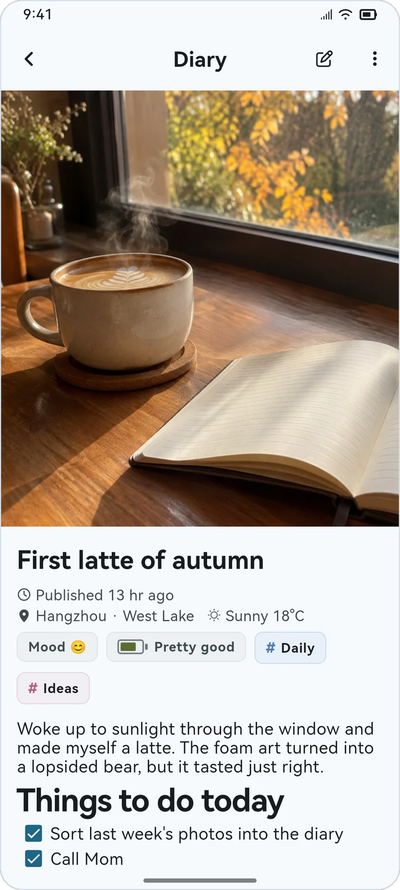 Diary detail</td>
  </tr>
</table>

- **23 editing tools**: headings, bold / italic / underline / strikethrough, text and background color, numbered / bulleted / checklists, quotes, code blocks, links, insert current time and more. Reorder or hide any of them.
- **Media**: insert several images or videos at once and attach files of any type. Voice recordings can be paused and resumed, and you can scrub the waveform during playback.
- **Here and now**: fetch your location and weather automatically, or type them in. Choose how precise the address is: city, district, street or house number.
- **Mood and energy**: 10 mood emojis (swap them in Settings) and 5 energy levels. The publish time can be changed at any time.
- **Never lose a draft**: new entries keep a draft, and edits to existing entries save automatically.

### 🗂️ Browse and organize

<table>
  <tr>
    <td align="center">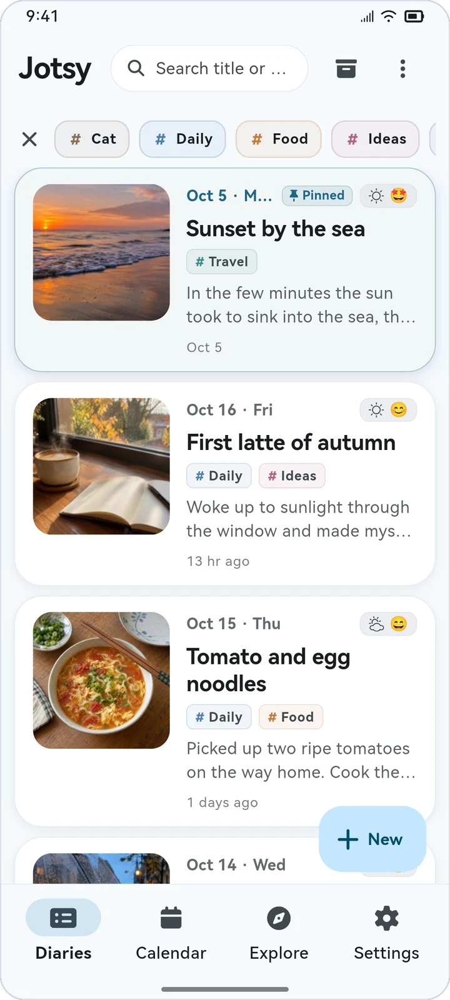 List view</td>
    <td align="center">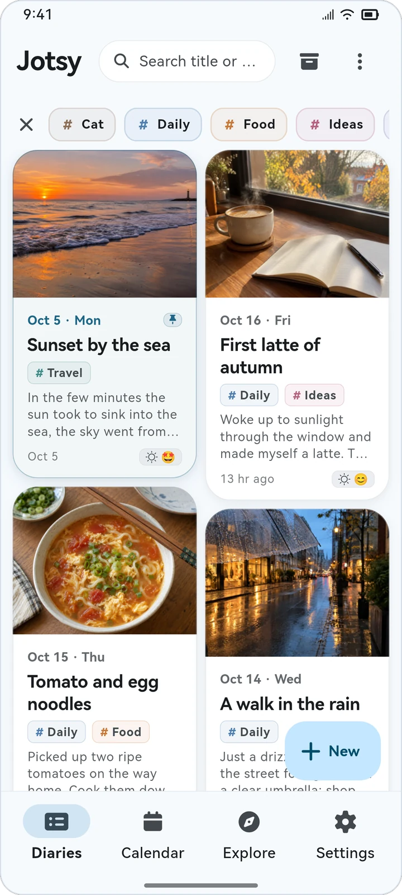 Waterfall view</td>
    <td align="center">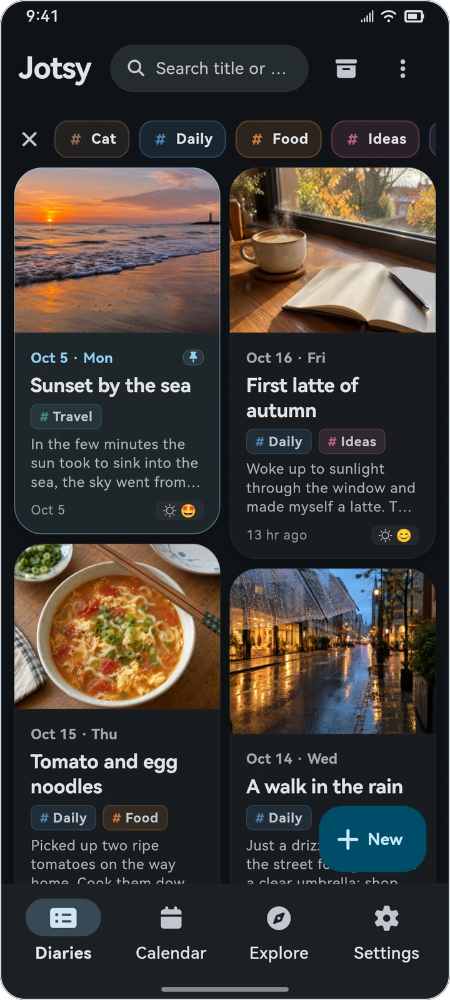 Dark theme</td>
  </tr>
</table>

- List or waterfall layout, sorted by date updated, date published or title.
- Filter by tags (optionally remembered for next time), and combine tag conditions with a title or content search.
- Pin, archive (just swipe left), and act on many entries at once. Deleted entries go to the recycle bin, with instant undo.

### 📅 Calendar: lunar dates, moods and photos

<table>
  <tr>
    <td align="center">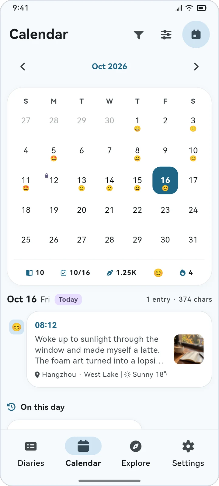 Moods at a glance</td>
    <td align="center">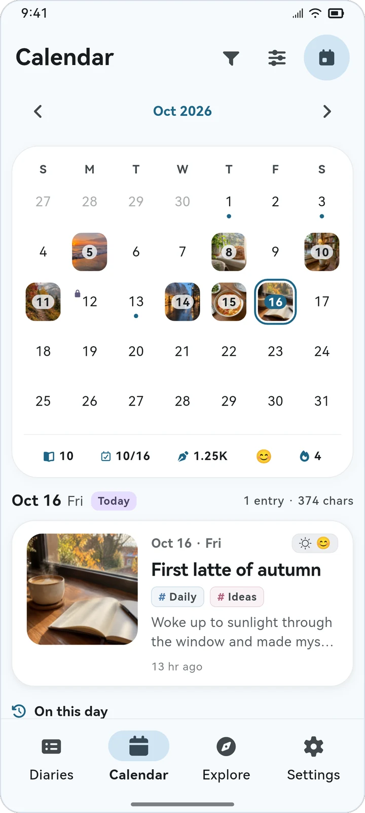 Photo style</td>
    <td align="center">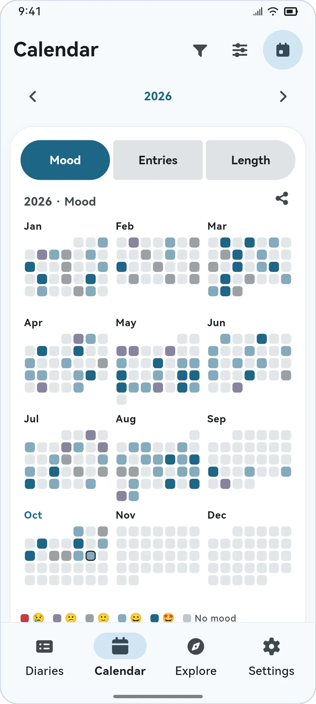 Yearly heatmap</td>
  </tr>
</table>

- Month and week views, with optional Chinese lunar dates, solar terms and festivals. Below the grid you get the month's entries, days written, characters, top mood and longest streak.
- Five day-cell styles: dot, mood, heat, photo and tags. Filter the calendar by mood or tag.
- Pick a start day and an end day to see stats for that range. The year view turns mood, entry count or length into a heatmap you can share as an image.
- Long-press any day to write an entry for it, or to write a time capsule for a future date.

### 🧭 Explore and remember

<table>
  <tr>
    <td align="center">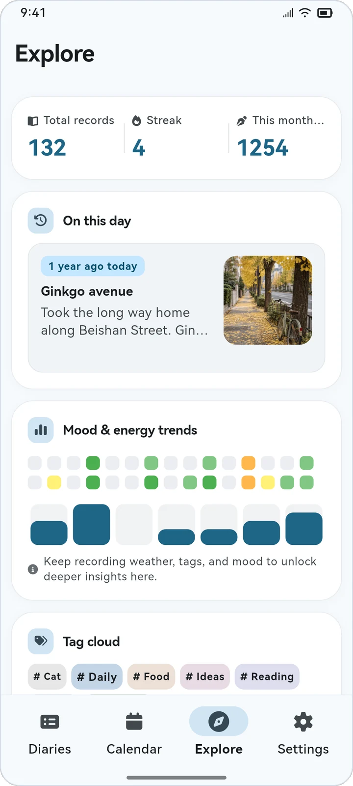 Stats, On this day and trends</td>
    <td align="center">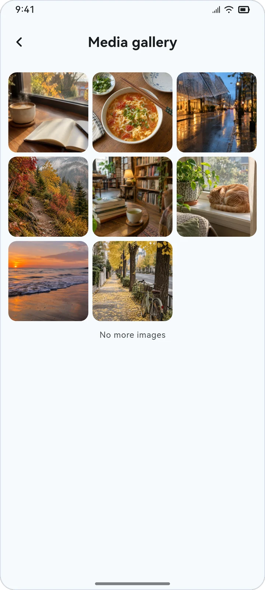 Media gallery</td>
    <td align="center">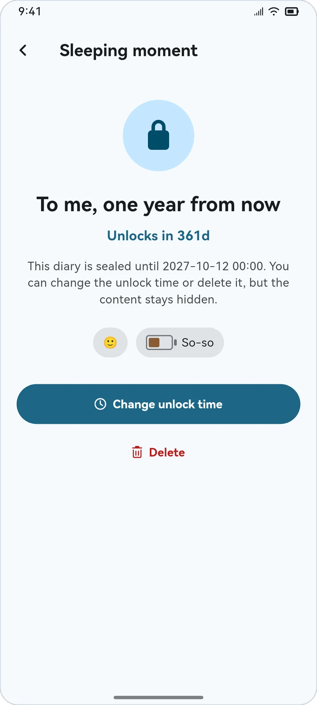 Time capsule</td>
  </tr>
</table>

- Total entries, current streak and characters written this month.
- **On this day**: entries from the same date in past years.
- **Trends and tag cloud**: mood over the last 30 days, energy over the last 7, and your most used tags.
- **Media gallery**: every cover and inline image in one place, with zoom, save and share.
- **Time capsules**: entries addressed to the future stay sealed until their unlock date.

### 🔐 Data, privacy and personalization

<table>
  <tr>
    <td align="center">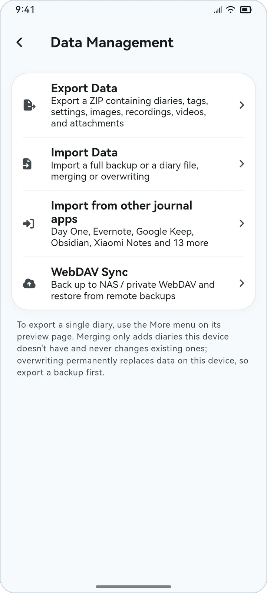 Backup, import and WebDAV</td>
    <td align="center">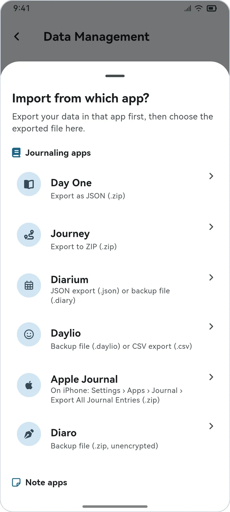 Import from 18 apps</td>
    <td align="center">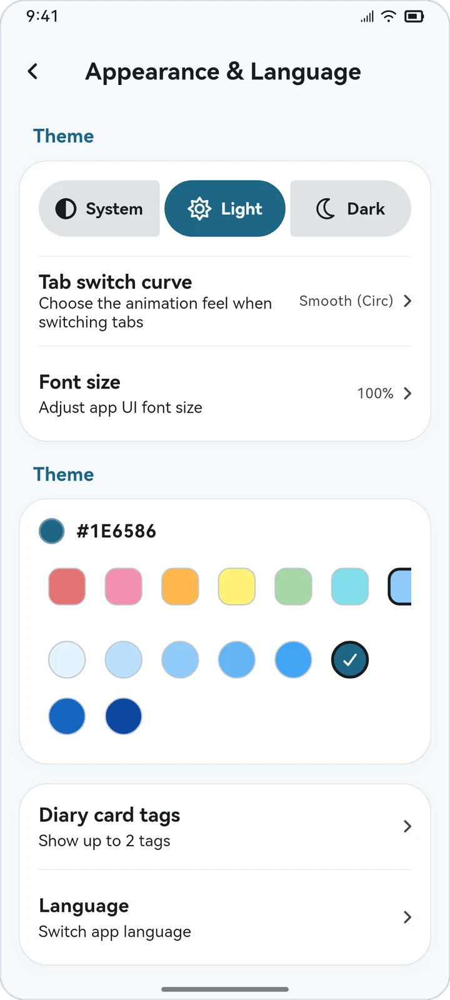 Themes and appearance</td>
  </tr>
</table>

- **App lock**: unlock with your device's biometrics or screen lock.
- **Full backups**: one ZIP with entries, tags, settings and every image, recording, video and attachment. Add a password for AES-256 encryption.
- **Merge or overwrite**: choose how a backup is restored. Overwriting local data asks for a clear second confirmation.
- **Cloud backup**: back up to WebDAV (Nextcloud, NAS, Alist…), S3-compatible object storage (R2, B2, OSS…) or Google Drive / OneDrive / Dropbox / Baidu Netdisk / Alipan, and restore from them directly. See [cloud_backup.md](cloud_backup.md).
- **Export**: one entry, a selection, or a date / tag range as PDF, Word, Markdown (with front matter, ready for Obsidian), a web page, plain text, CSV, or a diary file that can be merged on another device.
- **Share**: as a long image, or straight to Weibo, Xiaohongshu, WeChat and QQ with the text copied and the diary's photos attached.
- **Make it yours**: 80 theme colors in 10 families, adjustable UI font size, body text size and line height, in English or Chinese.

## 🔁 Moving from another app

Export your data from the old app first, then open **Settings › Data & Privacy › Data Management › Import from other journal apps** in Jotsy and pick the file. Jotsy previews the contents before importing, and you can choose to merge or overwrite.

| Type | Supported apps |
| :-- | :-- |
| Journaling apps | Day One · Journey · Diarium · Daylio · Apple Journal · Diaro |
| Note apps | Evernote · Google Keep · Joplin · Memos · Markdown / plain text (Obsidian, Bear, Notion exports and more) |
| Cloud notes | Xiaomi Notes · Huawei Notepad · OPPO Notes · vivo Notes · HONOR Notes · Meizu Notes · WPS Notes |

> For cloud notes, you sign in on the vendor's official website inside the app, and Jotsy only reads your notes. The login cookies exist only in memory for that import and are cleared when it ends. They are never written to storage or used for anything else.

## 📥 Download

> Jotsy is currently available for Android only (Android 7.0 or later).

1. Open the [Releases page](https://github.com/CikeSeven/jotsy/releases/latest).
2. Download the APK for your device:
   - `arm64-v8a`: almost every modern phone. Pick this one if you're not sure
   - `armeabi-v7a`: older 32-bit devices
   - `x86_64`: emulators
3. Install it and start writing. You can check for updates later in **Settings › About**.

## 🛡️ Privacy

Jotsy has no accounts and no server of its own. Entries are stored in a SQLite database in the app's private folder, next to your images, recordings, videos and attachments. Settings stay on the device too.

Jotsy only goes online in these cases, and only when you ask it to:

| When | Talks to | What is sent |
| :-- | :-- | :-- |
| Fetching location and weather | AMap, QWeather | Your current coordinates (or type them in yourself) |
| Cloud backup / restore | The server or drive you set up | Your backup file |
| Checking for updates (manual) | GitHub Releases and mirrors | No diary data |
| Importing cloud notes | The vendor's official website | The sign-in you complete there |

Permissions: internet, microphone (voice recordings), location (optional, for automatic location). See the full [privacy policy](https://cikeseven.github.io/jotsy/privacy.html).

## ❓ FAQ

<b>How do I move my diary to a new phone?</b>

On the old phone, go to **Data Management › Export Data** to create a backup ZIP. Copy it to the new phone and restore it with **Import Data**. You can also use cloud backup to pass it between devices.

<b>Why can't I get the weather or my location?</b>

Make sure location permission is granted and you are online. Either way, you can always type the location and weather in yourself.

<b>Will uninstalling the app delete my data?</b>

Yes. Your data only lives on the device, so uninstalling the app or clearing its data removes it. Export backups regularly, or set up cloud backups.

<b>Is there an iOS version?</b>

Not yet. Only Android builds are released for now.

## 💬 Feedback

- Found a bug or have an idea? Open an [issue](https://github.com/CikeSeven/jotsy/issues)
- QQ group: 678136434

## 📄 License

Jotsy is released under the [GPL-3.0](../LICENSE) license.

All entries, photos and places in the screenshots are demo data.
